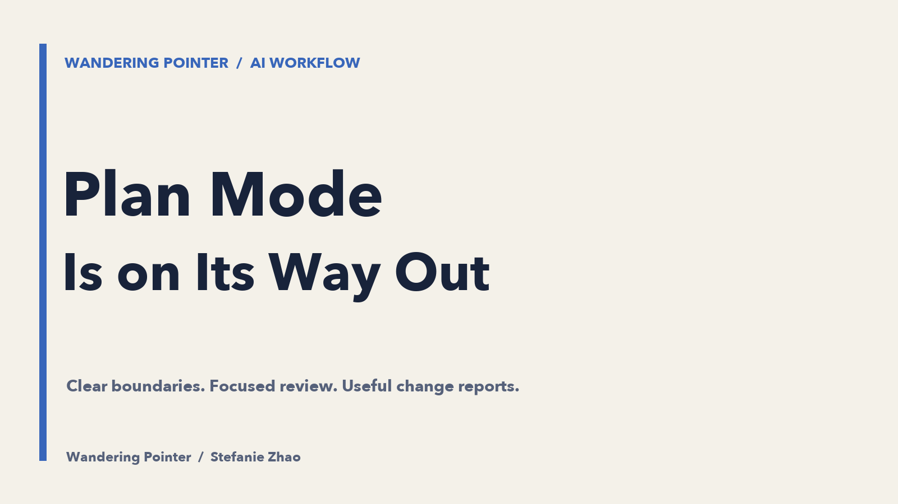

[中文版](/blog/2026/plan-mode-is-fading/)

Most people who use AI coding tools know Plan mode. In Claude Code, you can press Shift+Tab to enter it: the agent explores the codebase, asks questions, and proposes a plan before making changes. You discuss the details, approve the plan, and then let it work.

There is a technical distinction worth keeping clear. Claude Code’s documentation describes Plan mode as a workflow that researches and proposes changes while restricting source edits until approval. The handling of shell commands also depends on the session’s permissions and settings. Reducing all of that to “one extra prompt” would be misleading; I would not make an unverified claim about its internal tool definitions or prompt cache.

My real question is about the workflow: as models become more capable, do we still need planning and execution to be locked into separate modes?

## Plan mode has always had two jobs

Historically, Plan mode has served two purposes. It makes instructions precise enough for an agent to execute, and it helps the human understand what is about to happen.

I think those two jobs are moving in opposite directions. Stronger models need less help turning a general direction into executable steps. At the same time, the more an agent can do on its own, the more demanding human oversight becomes. There is simply more work to review than a person can comfortably keep up with.

The original assumption was reasonable: thinking everything through before starting is useful, and saving that thinking in a structured document is useful too. But as models improve and human review becomes the slowest part of the process, people lose patience with long specifications. “Build something first; fix what is wrong afterward” becomes an appealing choice.

Agents can communicate efficiently with one another. When a model’s language feels unlike ordinary human conversation, I sometimes see that as a kind of adaptation: it is compressing communication to get the task done. Keeping every exchange easy for a human to read can introduce its own overhead. That is my interpretation, rather than a claim that models literally evolve in the biological sense.

Meanwhile, nobody wants to read pages of AI-generated prose. A specification may contain more information without becoming any clearer. The longer and more detailed it gets, the easier it is to stop absorbing it. Eventually, you ask the AI to summarize its own document—and may discover that it has thought through the problem better than you have.

Planning and building have been split into two stages. The familiar sequence looks like this:

Chat → clarify → generate a spec → review → revise → approve → implement → review the code.

But that is not how I find it easiest to think. People rely heavily on concrete things they can see and try. You understand part of a problem, test something, learn from the result, change your mind, and try again. Requiring every detail to be settled before any implementation starts feels at odds with that process.

And even if you have worked through every detail, the agent may still miss something in the final implementation. A thorough document does not guarantee a complete delivery.

## I would be happy to drop the separate mode

Dropping Plan mode does not mean dropping planning. Before implementation, the agent still needs to understand four things:

1. The actual business logic.
2. The concrete details of the existing architecture.
3. The relevant edge cases.
4. The scope of the code changes.

My current workflow starts with a general direction. Then I ask the agent to clarify the details with me. Once we have done that, I ask it to write a `plan.md` that preserves the important decisions and constraints we discussed.

What I need to keep a firm grip on is that small set of important boundaries. Most of the remaining details are usually fine.

The implementation plan is a separate concern. I review the points that matter: is it reusing the existing architecture and interfaces? Does the proposed scope fit the project’s hard constraints and conventions? Are database permissions within the intended boundaries?

After each feature is finished, I also ask for a change report. I want to know which parts of the code changed and how they changed.

None of this has to become a document every time. One reason I write it down is to keep the agent from losing the decisions. Once the feature is implemented, I also want a concrete record of the solution for future reference.

My advice to developers is straightforward: you may spend less time reading every line of code, but you still need to understand and control the system as a whole. Documentation is one way to do that. Even when you cannot read everything closely, keep a record of the implementation logic that matters.

My argument is about reducing the ceremony around planning while keeping responsibility for the system. Clear boundaries, focused review, and a useful account of the finished work matter more to me than a dedicated mode.

Reference: [Claude Code’s official documentation on Plan mode and permission modes](https://code.claude.com/docs/en/permission-modes#analyze-before-you-edit-with-plan-mode). The workflow judgments and recommendations in this essay are my own.
