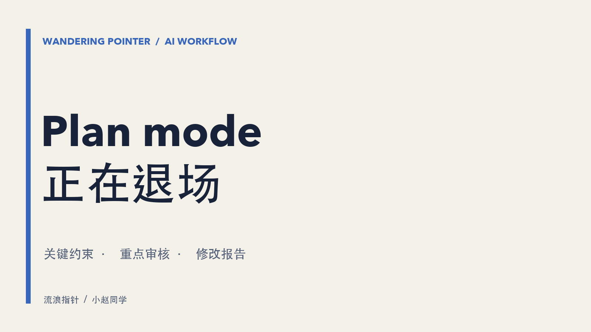

[English version](/blog/2026/plan-mode-is-fading-en/)

我相信大部分用AI工具的人都非常熟悉Plan mode。按一下 shift+tab，agent 进入只读状态，读代码、问你问题、写一份计划，但一个字都不许改。你跟它详细沟通清楚了，你同意了它才动手。

那它到底是怎么实现的呢？以 Claude Code 为例，Plan mode 会让 agent 先研究、提出方案，并在批准计划之前限制源码编辑。按官方文档，具体的命令审批行为还取决于会话权限和设置。它并不能简单归结为「多加一句提示词」，也不应把工具集和 prompt cache 的关系当作未经核实的实现细节。

但我更关心的是：随着模型越来越强，我们是否还需要把「先计划、再执行」固定成一个独立模式？

随着模型的能力越来越强，很多人都在讨论plan mode是否还有存在的意义。

## 计划模式一直在干两件事

plan mode 历史上同时承担两个角色，一是把指令变得足够精确，让 agent 能执行，二是帮人弄明白即将发生什么。

我的判断是这两个角色正在往相反的方向走。第一个随着模型变强在消失，第二个随着 agent 能自己干更多活在变重，现在人力根本就审核不过来。原来的假设是，动手之前有地方把事情彻底想一遍是有价值的，把这段思考存成一份结构化文档也是有价值的。结果现在随着模型能力的增强，以及人成为整个流程中效率最低的环节，越来越多的人对 spec的长文档失去了审核的耐心。先干，有毛病了再改成了大部分人的选择。

其实AI agent之间的交流可以是非常高效的，而且大家现在经常觉得很多大语言模型不说“人话”，其实是它们的一种“进化选择”。也就是说，它们为了更好地完成任务，而精简了它们的交流方式。在某种程度上来说，AI为了“顾虑”人类能读懂这件事，反而可能会拖累了AI。

而且，AI 生成的长文没人愿意读。spec 里的信息变多了，清晰度没变多，篇幅越长越详细，眼睛越容易发直。最后可能还是让AI精简一下，然后读下来发现自己想得还没有AI想得好呢。

规划和建造被切成了两段。之前推荐的流程是 聊天 → 澄清 → 生成 spec → 审 → 改 → 批准 → 实现 → 审代码。其实人类适合的思考模式不是这个样子的，人类是非常依赖视觉和具象事物，所以通常是搞懂一部分，试一下，试出来的东西教你新东西，于是你改主意再试一次。Plan mode让你非要全部都想好再弄，还挺反人类的。

而且还有一个问题，就算你把每一处的细节都想好了，AI最后也不一定会按照这份文档交付，总会有遗漏。

## 我是完全同意去掉Plan mode的

不要这个plan mode，不代表没有plan。其实在做一个plan之前，它应该理解几个点：

1. 真实的业务逻辑
2. 具体的代码架构细节
3. 可能的边界条件
4. 代码的修改范围

我现在的主要流程是给它一个大致的方向，然后让它跟我澄清每一个细节，让它在澄清之后输出一个plan.md的文档，这里面要保留我们所有重点讨论过的内容和细节，其实我只需要把所有这些比较重要的限制把握住，大部分的内容它都是没有问题的。
然后具体代码的实施计划是单独的，我会审核几个比较重要的点，譬如是否复用了现在的代码架构和接口，实施的范围和内容是否符合现有项目的硬性限制和规范，数据库的权限范围等等。
另外每次它完成后，我都会要求它输出一份修改报告，这样就知道这一个功能它修改了哪些代码，是怎么修改的。
这些东西也不是非要落成文档，主要是担心AI会忘记，然后功能实现之后，还需要生成一个具体的解决方案以供归档。

最后给所有开发人员一个忠告，你可以省去读代码细节的时间，但是对系统整体功能的把控还是需要有的。文档只是一种形式，就算没时间细读，重点的实现逻辑还是需要留个记录。

参考：[Claude Code 官方文档：Plan mode 与权限模式](https://code.claude.com/docs/en/permission-modes#analyze-before-you-edit-with-plan-mode)。本文关于工作流程的判断和建议是我的个人观点。
