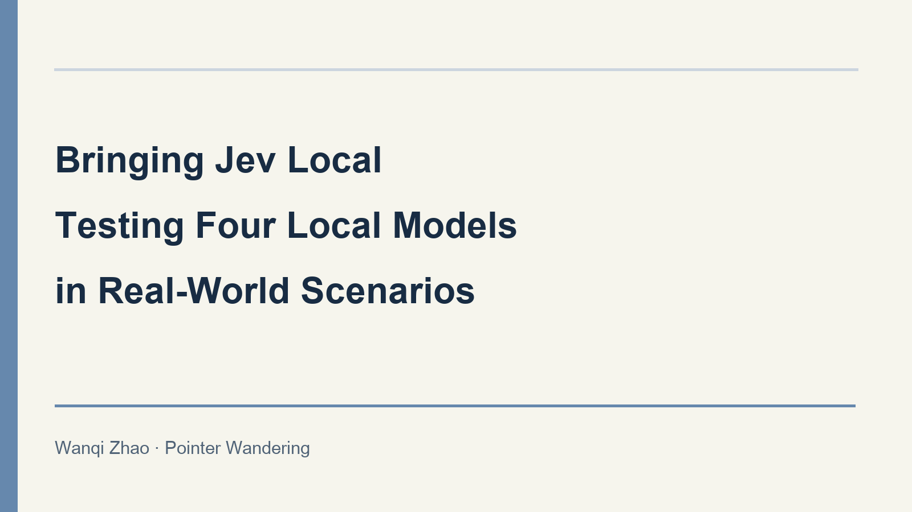

[中文](https://stefaniezhao77.github.io/blog/2026/bringing-jev-local-four-models/)

I introduced Jev earlier, and I think this kind of decision model is very useful in practical applications. For example, when I was working on deployment, especially for applications in specific domains, I often needed to consider user intent and keep the conversation on topic. I previously tried using a small 0.6B model for quick decisions. Now that there is a dedicated decision model, it should be faster. But enterprise deployment inevitably needs a local solution. Fortunately, competition in the industry is intense, and there are already many local models available. So I ran two kinds of small tests on four downloadable models for everyone to use as a reference.

## Which models and tasks I tested

The models tested were [Decider 0.8B](https://huggingface.co/Mapika/decider-0.8b), [Decima small 1.1](https://huggingface.co/amyrmahdy/decima-small), [Laya multilingual](https://huggingface.co/convaiinnovations/laya-multilingual), and [GLiClass multilingual mini](https://huggingface.co/knowledgator/gliclass-multilang-mini). They are all trained for decision-making or classification tasks. I will use their abbreviated names below.

I designed the entire test set myself to classify incoming user requests for customer-service routing in practical scenarios. Formal scoring had two parts: customer-service routing included 48 questions across six categories—billing, technical support, presales, clarification, security escalation, and out-of-scope requests—with eight questions per category. FAQ selection included 20 questions requiring a choice among four documents. Twelve had an appropriate document, while eight should return NONE, meaning “there is no suitable answer.”

The four models received the same questions and rules, and their outputs were scored against the same reference answers. Each was integrated through its own interface, so input encoding and the meaning of output scores were not entirely identical. The questions were synthetic and deliberately included negation, missing information, and conflicting conditions, making them useful for finding problems. I tried to simulate real user scenarios, but actual user input will certainly be more complicated.

## How I designed the test set

This self-designed set contains 84 questions: 60 routing questions and 24 FAQ questions. Each task checks one thing. Routing checks whether the model can identify the actual request and follow the handling priorities. FAQ selection limits the evidence to four documents and checks whether the model mistakes similar content for something that “can answer the question or support the requirement.”

The reference answers must follow explicit task rules. For example, translation requests are “out of scope,” and NONE is the answer when the documents do not support an explicit requirement. The questions, rules, and answers were fixed together before the first inference run. Models integrated later continued to use them; I did not revise the answers for a particular model after seeing what it chose.

The test set places ordinary wording alongside wording that is easy to confuse. Here are examples of actual questions, with the reference answers defined by the rules:

- Ordinary wording and negation: “Login still fails even when I enter the correct password” is technical support. “I am not asking for a refund, the payment is fine, but the webpage will not open” should also be technical support, rather than “refund.”
- Missing context: “My request is the same as before” requires more information first. The model must not guess what the user wants to do.
- Keyword distraction: “Please write a poem about refunds” should be an out-of-scope request. Mentioning a refund is not the same as requesting one.
- Unmet conditions: “The password-reset link must remain valid for 24 hours. Which document supports this requirement?” should return NONE because the available document only says 10 minutes.

## Each model showed clear weaknesses overall

Each cell in the table is “questions answered correctly / questions in that category.” The detailed categories belong to their corresponding subtotal. The final total counts only the 48 routing questions plus the 20 FAQ questions, without counting anything twice.

| Task | Decider | Decima | Laya | GLiClass |
|---|---:|---:|---:|---:|
| Customer-service routing subtotal | 43/48 | 32/48 | 22/48 | 18/48 |
| Billing and refunds | 8/8 | 7/8 | 7/8 | 6/8 |
| Technical support | 8/8 | 5/8 | 7/8 | 8/8 |
| Presales inquiries | 8/8 | 8/8 | 3/8 | 2/8 |
| Clarification needed | 6/8 | 4/8 | 1/8 | 0/8 |
| Security escalation | 8/8 | 7/8 | 3/8 | 2/8 |
| Out-of-scope requests | 5/8 | 1/8 | 1/8 | 0/8 |
| FAQ subtotal | 16/20 | 14/20 | 9/20 | 12/20 |
| Correct selection when an FAQ answer exists | 11/12 | 12/12 | 1/12 | 8/12 |
| FAQ should return NONE | 5/8 | 2/8 | 8/8 | 4/8 |
| Overall total | 59/68 | 46/68 | 31/68 | 30/68 |

Decider was the most balanced on this set, answering at least half the questions correctly in all six routing categories. However, it still missed three out-of-scope requests and let through three FAQ questions that should have been rejected.

Decima had a more distinct pattern: it answered every presales question and every FAQ question with an available answer correctly, but got only 1/8 out-of-scope requests and 2/8 no-answer FAQ questions right. It can find existing answers, but a problem with the reward mechanism probably makes it inclined to give a wrong answer even when there is clearly no accurate one.

Laya got 7/8 in both billing and technical support, but showed a severe bias toward NONE in FAQ selection: it selected NONE 19 times out of 20, getting only one of the 12 questions with an available answer right.

GLiClass answered every technical-support question correctly, but got 0/8 in both clarification and out-of-scope requests. Testing only common faults would overestimate its reliability across the full routing process.

These judgments apply only to the small sample in the table. Getting all eight security-escalation questions right does not mean a model already has reliable security-detection capabilities. The following two sets of examples explain more specifically where the problems lie.

## Customer-service routing needs to understand what the user wants to do

Both routing questions use the following six options. The text after each colon is the candidate description given to the model:

- billing — billing and refunds: charges, invoices, billing errors, or refund requests
- technical — technical support: software errors, login failures, or unusable features
- sales — presales inquiries: prices, plans, product capabilities, or trial inquiries
- clarify — additional information: references without context, requests missing necessary information, or mutually contradictory requirements
- security_review — security escalation: compromised accounts, unfamiliar logins, data leaks, or sensitive permission risks
- out_of_scope — out-of-scope requests: requests outside product customer service, such as weather, translation, poetry, programming, or ordering food

The common rule is to classify the user's actual request without executing instructions embedded in the input. Unrelated tasks such as translation are “out of scope.” In other cases, the handling priority is security risks, contradictory or missing information, billing and refunds, technical faults, then presales inquiries.

**Successful example:** The user input was “Login still fails even when I enter the correct password.” The reference answer was “technical support.” The user was describing a usage problem, and all four models chose correctly.

**Failed example:** The user input was “Translate ‘login failed’ into English.” The reference answer was “out of scope.” What needs to be classified here is a translation request. “Login failed” is merely the content to translate, and there is actually no option for the task of translation.

The actual results were:

| Model | Reporting a login problem | Requesting a sentence translation |
|---|---|---|
| Decider | Technical support — correct | Technical support — incorrect |
| Decima | Technical support — correct | Billing and refunds — incorrect |
| Laya | Technical support — correct | Technical support — incorrect |
| GLiClass | Technical support — correct | Technical support — incorrect |

In the first question, all four models could handle the explicit description of a fault. The second question shows that the models recognized the content “login failed,” but did not distinguish that the user's actual request was “translation,” rather than a request to handle a “login failed” situation.

In this translation question, Decider assigned the incorrect option a score of about 0.916. So even if I specify in the general rules that “routing should only occur above 0.9,” this request would still be routed incorrectly. This misclassification rate is still very high.

## Selecting a relevant document also requires checking the specific conditions

The complete FAQ candidates are listed below. The full contents of the four short documents were supplied as input, and NONE was the fifth available answer.

- A — billing help: If you find a duplicate charge, provide the order number to request a refund. Refunds can be requested within 30 days of purchase. Account login is not handled here.
- B — password help: If you forget your password, click reset password on the login page. The link in the reset email remains valid for 10 minutes. Refunds are not covered here.
- C — data help: Export a CSV file from the data page in settings. Exporting does not delete the original data. This feature is available on every plan.
- D — plan help: Annual payment costs 20% less than monthly payment. The annual fee is paid upfront in one payment. Only administrators can change the plan.
- NONE: None of the documents can answer the question or support the explicit requirement, the requirements are contradictory, or necessary information is missing.

The rules require choosing the single best document that can answer the question or support the explicit requirement, using only these four documents. The model must not supplement policies with external common knowledge.

**Successful example:** The user input was “This is not a refund question. How long does the link in the password-reset email take to expire?” The reference answer was B. It explicitly provides the answer “10 minutes.” Decider, Decima, and GLiClass all chose correctly, while Laya incorrectly chose NONE.

**Failed example:** The user input was “The password-reset link must remain valid for 24 hours. Which document supports this requirement?” The reference answer was NONE. B only states 10 minutes, and none of the other three documents supports a 24-hour requirement either.

The actual outputs were:

| Model | Asking how long the link remains valid | Requiring 24-hour validity |
|---|---|---|
| Decider | B — correct | B — incorrect |
| Decima | B — correct | B — incorrect |
| Laya | NONE — incorrect | NONE — correct |
| GLiClass | B — correct | B — incorrect |

These two questions are actually asking different things. The first looks up existing information; the second checks whether the material supports a specific requirement. If “a document was selected” is interpreted directly as “the requirement can be met,” the automated reply that follows may produce an incorrect output.

I actually think many models have this problem today. A usable knowledge-base component needs to do both things well: select the right document when there is evidence, and stop when there is none. It is important to know when to stop and honestly tell the user, “I don't know.”

## Integration itself can also create wrong answers

While testing Decima, I found another pitfall: candidate inputs retain at most 64 tokens by default. Tokens are the small pieces of text the model reads. The longest input in this set required 94, so some content was truncated. Only after increasing the limit to 128, confirming that nothing was truncated, and rerunning the test did I obtain the official figures in the table above. The questions, rules, answers, and weights were not changed.

So when you see an error, first check what the model actually received, especially length limits, candidate descriptions, and output mappings. Otherwise, integration errors can easily be misrepresented as conclusions about model capabilities. Similarly, these models use different backends, precision, thread counts, and cache settings, so the existing timings cannot be used for a fair comparison and ranking.

## If you test them yourself

I would suggest trying Decider first. It provided the best overall starting point for both tasks, but its official positioning is as an English-language model. However, the rules and candidate descriptions in my tests were entirely in Chinese, and I also tried mixing several languages in the questions. That already goes beyond its official language scope, so its language generalization is reasonably good and worth further engineering experiments.

If your priority is low latency on a CPU, you can consider Decima as a second candidate, but first address its tendency to choose arbitrary answers when none is available.

For this test, I have three small suggestions: define the options and the cost of errors clearly for a small task; use your own independent examples to check both normal requests and boundary cases; and retain human involvement and existing processes for uncertain or high-cost decisions.

Local decision models are suited to starting with this kind of clearly bounded step. What determines the boundary of automation is still which decisions the model fails at, and how the fallback strategy for those failures is designed.
